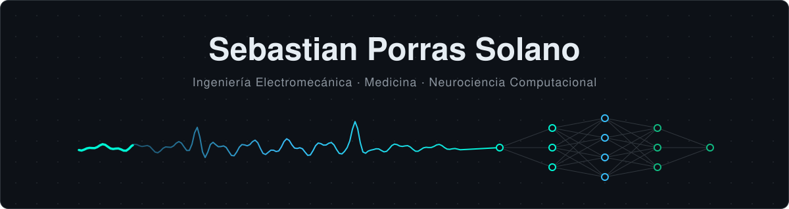

  

Doble carrera en la <b>Universidad de Costa Rica</b>, entre la ingeniería y el cerebro. 
Fundador de <b>Lilith Technologies</b>: investigación aplicada, software, ciberseguridad y tecnología biomédica.

 

<h3>Enfoque</h3>

<table>
<tr>
<th width="280">Neurotech</th>
<th width="280">IA &amp; Datos</th>
<th width="280">Sistemas &amp; Seguridad</th>
</tr>
<tr>
<td align="center">EEG en 3D Control de prótesis Modelado cerebral</td>
<td align="center">Redes neuronales desde cero Visión por computadora Análisis biomédico</td>
<td align="center">Arquitectura de software Linux, redes y servidores Encriptación automatizada</td>
</tr>
</table>

<h3>Investigación</h3>

<b>Tesis</b> · Modelo matemático de la percepción temporal y la construcción de la realidad 
<b>NASA</b> · Ex-pasante: imágenes de telescopios de campo profundo en Python 
<b>Consultoría</b> · Ciberseguridad, redes Linux y software

<h3>Proyectos</h3>

<table>
<tr>
<td align="center" width="420"><a href="https://github.com/ImJustSebas/SpeakToText"><b>SpeakToText</b></a> Transcripción y procesamiento de voz</td>
<td align="center" width="420"><a href="https://github.com/ImJustSebas/PdfToMarkdown"><b>PdfToMarkdown</b></a> Conversión estructurada de documentos</td>
</tr>
<tr>
<td align="center"><a href="https://github.com/ImJustSebas/Scrcpy-UI"><b>Scrcpy-UI</b></a> Interfaz gráfica para control de dispositivos</td>
<td align="center"><a href="https://github.com/ImJustSebas/VlogStudy-App"><b>VlogStudy-App</b></a> Organización y estudio</td>
</tr>
</table>

<h3>Stack</h3>

 

Español (nativo) · Inglés (profesional completo) · Alemán e Italiano (básico profesional)

