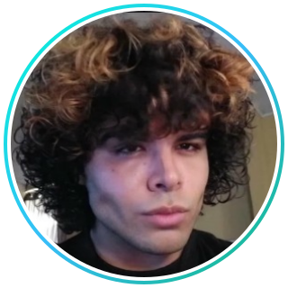
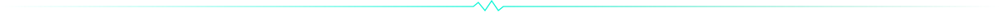
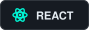

  

  

<b>Ingeniería Electromecánica</b> (UCR) 
<b>Medicina y Cirugía</b> · Penn State  
Fundador de <b>Lilith Technologies</b>: investigación aplicada, software, ciberseguridad y tecnología biomédica.

 

<h3>Enfoque</h3>

<table>
<tr>
<th width="280">Neurotech</th>
<th width="280">IA &amp; Datos</th>
<th width="280">Sistemas &amp; Seguridad</th>
</tr>
<tr>
<td align="center">EEG en 3D Control de prótesis Modelado cerebral</td>
<td align="center">Redes neuronales desde cero Visión por computadora Análisis biomédico</td>
<td align="center">Arquitectura de software Linux, redes y servidores Encriptación automatizada</td>
</tr>
</table>

<h3>Investigación</h3>

Actualmente desarrollo mi tesis para el <b>Departamento de Ciencias Computacionales</b>: un modelo matemático de la <b>percepción temporal</b> que busca describir cómo el cerebro construye la realidad.
En paralelo, desde <b>Lilith Technologies</b> impulso investigación aplicada y desarrollo en software, ciberseguridad, diseño electromecánico y tecnología biomédica.
Mi trabajo se apoya en experiencia previa como pasante de investigación en la <b>NASA</b>, donde desarrollé algoritmos en Python para procesar imágenes de telescopios de campo profundo y modelar el mapeo de datos.

<h3>Stack</h3>

 

 

 

Español · Inglés · Alemán · Italiano

